One of the most important tools a new witch can have is well vetted and reliable sources for information. 

Below you'll find curated recommendations for books, podcasts, and videos that prioritize historical accuracy, academic rigor, and practical application over aesthetic trends. If you already know where your practice is heading, the topic guides for [Irish paganism](/irish-paganism-books-resources), [chaos magic](/chaos-magic-books-for-beginners), and [tarot](/tarot-books-for-beginners) go deeper.

The podcasts and videos are free, and most books should be available at your local library.

## Books

<a href="https://bookshop.org/a/84772/9781982174347" target="_blank" rel="noopener noreferrer">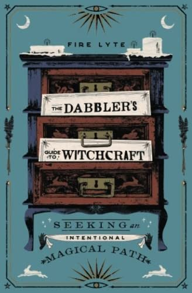</a>

### [The Dabbler's Guide to Witchcraft by Fire Lyte](https://bookshop.org/a/84772/9781982174347){:target="_blank" rel="noopener noreferrer"}
This is my go-to recommendation for all beginner witches. It's a wonderful introduction to the basics of witchcraft and gives you a great foundation for how to vet other sources you come across in your studies.

Fire Lyte spent more than ten years interviewing witches, fairy experts and paranormal investigators on his podcast, Inciting A Riot, before writing it. The book covers pop culture witchcraft and the overlap between science and spirituality, and it asks you to look hard at what other people in the community are trying to sell you.

<a href="https://bookshop.org/a/84772/9781571313560" target="_blank" rel="noopener noreferrer">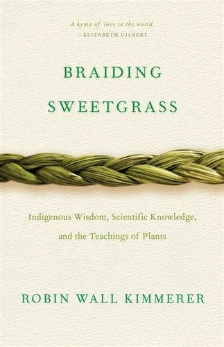</a>

### [Braiding Sweetgrass by Robin Wall Kimmerer](https://bookshop.org/a/84772/9781571313560){:target="_blank" rel="noopener noreferrer"}
This book does an amazing job of showing how different types of "knowing" that may seem at odds can weave together and complement one another. Kimmerer tells us how she braids together her traditional training as a botanist and knowledge of plants that she learned as a citizen of the Potawatomi Nation.

Kimmerer teaches environmental biology at SUNY in Syracuse. The book is a collection of essays arranged like the braid in its title, in five sections that move from planting sweetgrass through tending, picking, braiding and burning it. Reciprocity, meaning what we owe the land in return for what it gives us, runs under most of them.

<a href="https://bookshop.org/a/84772/9780764361531" target="_blank" rel="noopener noreferrer">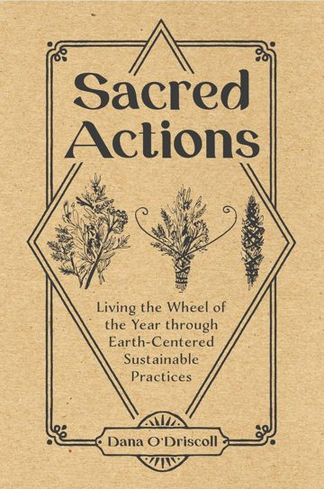</a>

### [Sacred Actions by Dana O'Driscoll](https://bookshop.org/a/84772/9780764361531){:target="_blank" rel="noopener noreferrer"}
If you want to learn how to combine sustainable living with Earth-based spirituality, this is the book for you! This is a book that will meet you where you're at in your sustainability practice and give you a concrete plan for where to go next.

O'Driscoll is Grand Archdruid of the Ancient Order of Druids in America and a certified permaculture designer and teacher. The book follows the eight festivals of the Wheel of the Year, starting at the Winter Solstice, and pairs each one with sustainable-living practices, rituals and projects, like making your own ritual items and offerings.

<a href="https://bookshop.org/a/84772/9780999356609" target="_blank" rel="noopener noreferrer">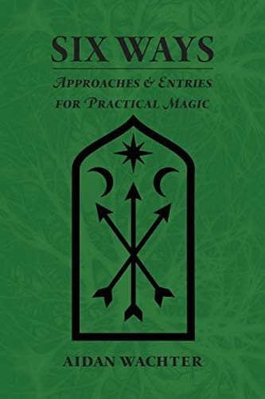</a>

### [Six Ways by Aidan Wachter](https://bookshop.org/a/84772/9780999356609){:target="_blank" rel="noopener noreferrer"}
Six Ways is one of my recommendations for every new practitioner. It’s a short book, under 200 pages, and it gets you doing magic fast: building relationships with spirit allies, making sigils, working with energy. Wachter is a talismanic jeweler whose practice draws on witchcraft, folk magic, chaos magic and animism, and he writes like someone explaining his own workbench.

<a href="https://bookshop.org/a/84772/9781523090990" target="_blank" rel="noopener noreferrer">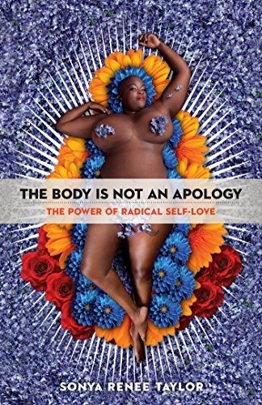</a>

### [The Body Is Not an Apology by Sonya Renee Taylor](https://bookshop.org/a/84772/9781523090990){:target="_blank" rel="noopener noreferrer"}
Systems of oppression thrive off our inability to make peace with difference and injure the relationship we have with our own bodies. Taylor's solution of radical self-love offers us a chance to heal. Learning to love yourself as you are is one of the most powerful things you can do for yourself.

Taylor is a poet and activist and the founder of The Body Is Not an Apology, a media and education company built around radical self-love. The second edition, linked here, adds a final chapter with tools for confronting racism, sexism, ableism, homophobia and transphobia. If you want exercises to go with it, Taylor also wrote a companion workbook, Your Body Is Not an Apology.

---

## Podcasts

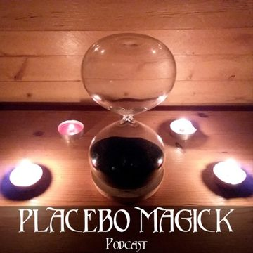

### [Placebo Magick](https://www.farmcodegary.com/){:target="_blank" rel="noopener noreferrer"}
A podcast that examines magick, ritual, tarot all while remaining grounded in a science-based skeptical atheist worldview. The show ended in 2023, but the back catalog is worth listening to.

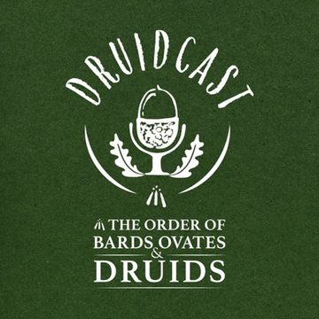

### [DruidCast](https://druidry.org/resources/druidcast-the-obod-podcast){:target="_blank" rel="noopener noreferrer"}
A podcast from the Order of Bards, Ovates & Druids, it's a mix of music, poetry and artist and author interviews.

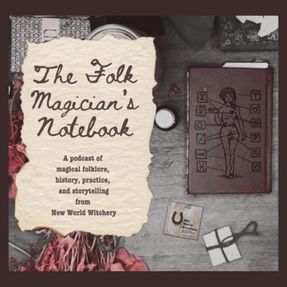

### [New World Witchery](https://newworldwitchery.com/){:target="_blank" rel="noopener noreferrer"}
This is a fun show, full of great bits of folk wisdom. Folklorist Cory Thomas Hutcheson and his co-host Laine dig into North American folk magic: the charms, cures and beliefs people actually used, and how to work with them today. Cory's book, [New World Witchery](https://bookshop.org/a/84772/9780738762128){:target="_blank" rel="noopener noreferrer"}, covers the same ground in print. Their monthly calendar episode is especially useful.

### [Oh No! Ross and Carrie](https://ohnopodcast.com/){:target="_blank" rel="noopener noreferrer"}
A great podcast to keep you grounded, and learn how to spot a woo scam! Ross and Carrie join religions, undergo alternative medical treatments, and hunt for ghost, goblins, demons, and deities and report back on what they find. The show ended in 2024, but the back catalog is worth listening to.

### [The Fat Feminist Witch](https://thefatfeministwitch.com/){:target="_blank" rel="noopener noreferrer"}
Witchcraft and spirituality from a modern, fat, feminist perspective.

### [Tara Brach](https://open.spotify.com/show/37McjD0j2cdu4GExcFQgm0?si=dgxSVe1zRNWYctjmlhJBgA&dl_branch=1){:target="_blank" rel="noopener noreferrer"}
Tara shares a weekly guided meditation and talk that address the value of mindfulness meditation and self-compassion in relieving emotional suffering, serving spiritual awakening and bringing healing to our world.

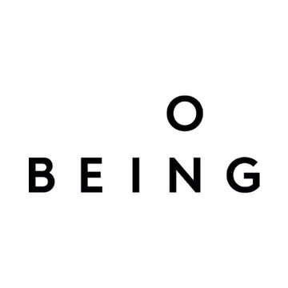

### [On Being](https://onbeing.org/starting-points/new-to-on-being-start-here/){:target="_blank" rel="noopener noreferrer"}
On Being examines what it calls the, "animating questions at the center of human life: What does it mean to be human, and how do we want to live?"

---
## Videos

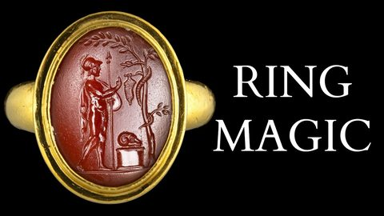

### [Esoterica](https://www.youtube.com/@TheEsotericaChannel){:target="_blank" rel="noopener noreferrer"}
A deep academic dives into the actual historical texts of Western esotericism are invaluable for understanding what practitioners really believed and did throughout history. His lectures help you build a foundation based on what the sources actually say rather than modern assumptions, covering everything from Kabbalah to alchemy to Gnosticism with rigorous scholarship made accessible.

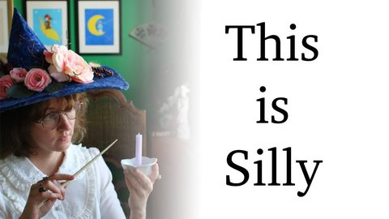

### [Sedna Woo](https://www.youtube.com/channel/UCKpiaNefOjsgjL4u3PT7CNQ){:target="_blank" rel="noopener noreferrer"}
Sedna offers practical, no-nonsense folk magic and traditional witchcraft that prioritizes what actually works over what looks pretty on Instagram. Her approach is perfect for beginners who want to practice magic rather than just collect aesthetic objects and worry about doing everything "right." The channel stopped posting in 2025, but the back catalog is worth watching.

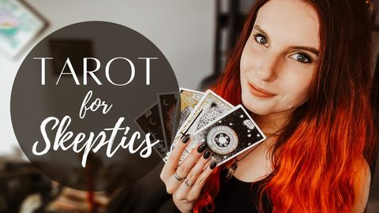

### [Entangled Encounters](https://www.youtube.com/channel/UCWYaJlQZ7zGSfJv-INEgo1A){:target="_blank" rel="noopener noreferrer"}
This channel bridges academic religious studies with personal practice, showing how ancient magical traditions connect to modern approaches without romanticizing the past. It's great for learning the scholarly context behind practices while understanding how to work with them respectfully in your own life. The channel stopped posting in 2025, but the back catalog is worth watching.

## Western Esoteric Traditions

Western esotericism covers centuries of material, from Renaissance Hermeticism to modern ceremonial magic, and it can feel overwhelming at first. You don't need to study all of it. Gerald Gardner, who founded Wicca, built it largely out of these traditions, especially ceremonial magic. That's why so much of modern pagan practice, like casting a circle and calling the four elements, traces back to them. A general sense of that history helps, because knowing where an idea came from makes it easier to decide how you want to use it in your own practice.

<a href="https://bookshop.org/a/84772/9781441136466" target="_blank" rel="noopener noreferrer">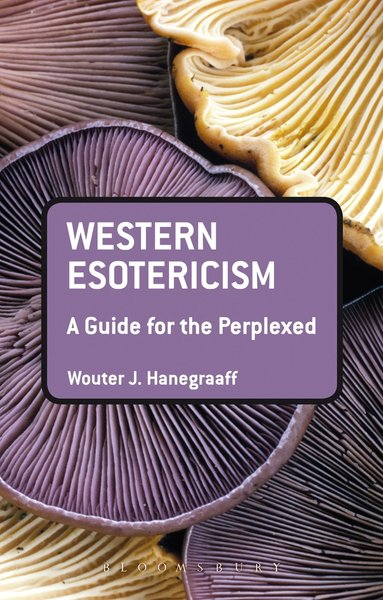</a>

### [Western Esotericism: A Guide for the Perplexed by Wouter J. Hanegraaff](https://bookshop.org/a/84772/9781441136466){:target="_blank" rel="noopener noreferrer"}
Wouter Hanegraaff, a historian at the University of Amsterdam, helped make Western esotericism an academic field. This short book explains what the term means and traces the traditions it covers, from Renaissance Hermeticism to modern occultism.

<a href="https://bookshop.org/a/84772/9781578637881" target="_blank" rel="noopener noreferrer">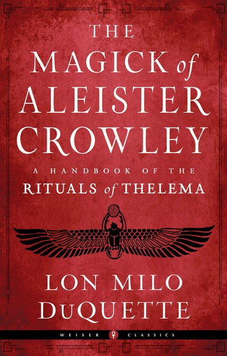</a>

### [The Magick of Aleister Crowley by Lon Milo DuQuette](https://bookshop.org/a/84772/9781578637881){:target="_blank" rel="noopener noreferrer"}
Lon Milo DuQuette walks through the core rituals of Thelema, Crowley's magical and religious system. He explains what each ritual does and how to perform it.

<a href="https://bookshop.org/a/84772/9780738776071" target="_blank" rel="noopener noreferrer">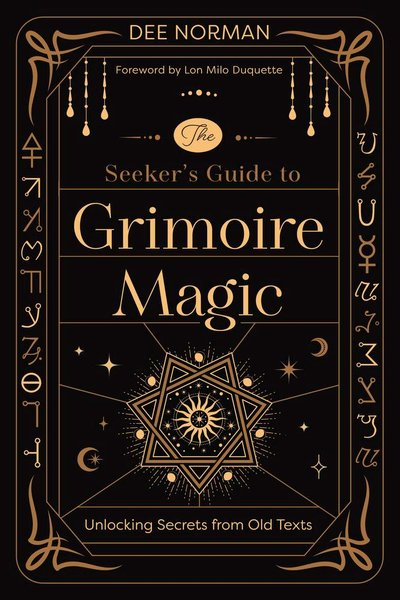</a>

### [The Seeker's Guide to Grimoire Magic by Dee Norman](https://bookshop.org/a/84772/9780738776071){:target="_blank" rel="noopener noreferrer"}
Dee Norman shows you how to read old grimoires like the *Key of Solomon* and the *Ars Notoria*, and how to adapt their talismans and rituals for modern practice. It includes hands-on exercises and an annotated list of historical texts.

<a href="https://bookshop.org/a/84772/9781578639212" target="_blank" rel="noopener noreferrer">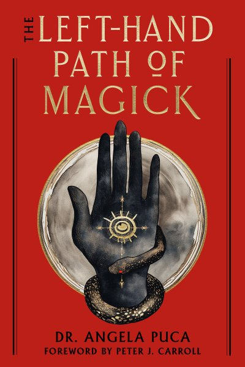</a>

### [The Left-Hand Path of Magick by Dr. Angela Puca](https://bookshop.org/a/84772/9781578639212){:target="_blank" rel="noopener noreferrer"}
Dr. Angela Puca, a scholar of religion, traces the Left-Hand Path from Tantra through Theosophy, Thelema, chaos magick, Satanism and Luciferianism. It's written for general readers and doesn't argue for any one tradition. It comes out December 7, 2026, and is available for pre-order.

<a href="https://bookshop.org/a/84772/9781138856110" target="_blank" rel="noopener noreferrer">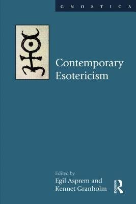</a>

### [Contemporary Esotericism](https://bookshop.org/a/84772/9781138856110){:target="_blank" rel="noopener noreferrer"}
Egil Asprem and Kennet Granholm collect academic essays on modern esoteric movements, including chaos magic. It's written for an academic audience.

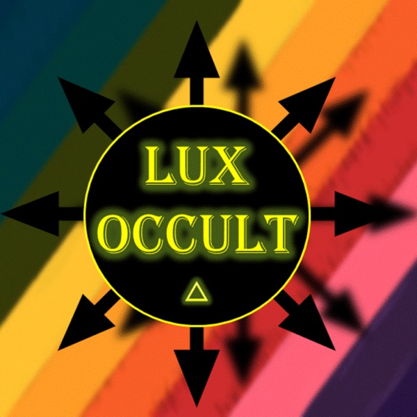

### [Lux Occult](https://creators.spotify.com/pod/profile/luxa-strata/){:target="_blank" rel="noopener noreferrer"}
Luxa Strata interviews magicians, artists and authors about chaos magic, tarot and occult history. There are over 100 episodes.

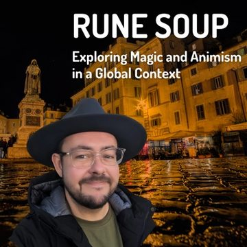

### [Rune Soup](https://runesoup.com/){:target="_blank" rel="noopener noreferrer"}
Gordon White, author of *The Chaos Protocols*, started Rune Soup as a chaos magick blog. The podcast now covers magic, animism and spirit work more broadly, through long interviews with practitioners and scholars.

### [The Digital Ambler](https://digitalambler.com/){:target="_blank" rel="noopener noreferrer"}
polyphanes writes about Hermetic and Greco-Egyptian practice, with free prayers, rituals and a lot on geomancy.

---

## Topic Guides

Each of these pages collects books, podcasts, and videos for one area of practice.

* [Irish Paganism Books and Resources](/irish-paganism-books-resources): folk magic and customs, myth translations, folklore collections, and Irish mythology podcasts.
* [Chaos Magic Books for Beginners](/chaos-magic-books-for-beginners): where to start with the practical manuals, plus histories of the movement.
* [Tarot Books for Beginners](/tarot-books-for-beginners): books and podcasts for learning the cards past the little white book.
