Chaos magic has a documented history, which keeps its reading list short. The founding texts came from the practitioners who started the movement in England in the late 1970s, and newer books translate those ideas for people starting today.

If you're brand new, read [Chaos Magic for the Curious](/what-is-chaos-magic) and keep the [chaos magic glossary](/chaos-magic-terms-explained) open. The guides to [gnosis techniques](/gnosis-techniques-chaos-magic) and [making sigils](/how-to-make-sigils-austin-osman-spare-method) give you something to practice while you read. For general starting points outside chaos magic, see [beginner witchcraft resources](/recommendations/).

## Books to Start With

<a href="https://bookshop.org/a/84772/9781578637669" target="_blank" rel="noopener noreferrer">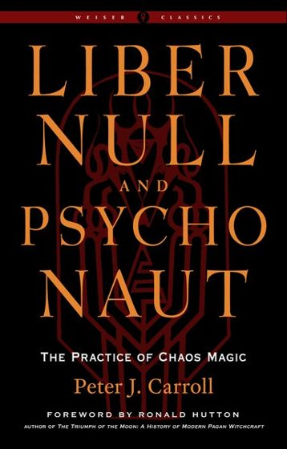</a>

### [Liber Null & Psychonaut by Peter J. Carroll](https://bookshop.org/a/84772/9781578637669){:target="_blank" rel="noopener noreferrer"}
Peter Carroll's early manual is one of my recommendations for new practitioners. It's a practical book, so it uses terms like gnosis and servitor without stopping to explain them. Read it with the [glossary](/chaos-magic-terms-explained) beside you.

<a href="https://bookshop.org/a/84772/9781618696618" target="_blank" rel="noopener noreferrer">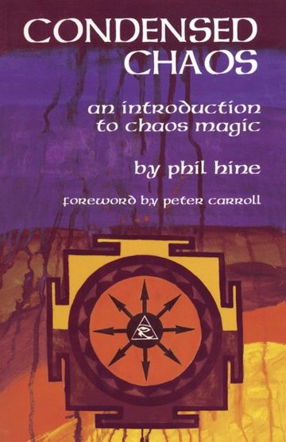</a>

### [Condensed Chaos by Phil Hine](https://bookshop.org/a/84772/9781618696618){:target="_blank" rel="noopener noreferrer"}
Phil Hine's introduction to chaos magic covers the core techniques in plain language. His point that a new belief system changes what you do and how you carry yourself during a working is the idea behind [paradigm shifting](/chaos-magic-paradigm-shifting).

<a href="https://bookshop.org/a/84772/9781803418728" target="_blank" rel="noopener noreferrer">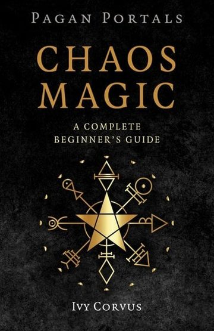</a>

### [Pagan Portals: Chaos Magic: A Complete Beginner's Guide by Ivy Corvus](https://bookshop.org/a/84772/9781803418728){:target="_blank" rel="noopener noreferrer"}
Ivy Corvus runs the [Ivy the Occultist](#videos) YouTube channel listed below, and this short 2026 book is just as practical. The first half covers the core ideas of chaos magic. The second half gives you techniques to try them out.

<a href="https://bookshop.org/a/84772/9781904658412" target="_blank" rel="noopener noreferrer">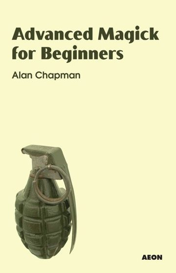</a>

### [Advanced Magick for Beginners by Alan Chapman](https://bookshop.org/a/84772/9781904658412){:target="_blank" rel="noopener noreferrer"}
Despite the title, this is a beginner's book. Chapman assumes no previous knowledge and treats magic as a set of techniques you judge by their results.

## History and Context

These books explain where chaos magic came from. They pair well with the [brief history of chaos magic](/history-of-chaos-magic). Chaos magic grew out of older Western esoteric traditions like Thelema and ceremonial magic, and the [Western esoteric resources](/recommendations/#western-esoteric-traditions) cover that background.

<a href="https://bookshop.org/a/84772/9781578638734" target="_blank" rel="noopener noreferrer">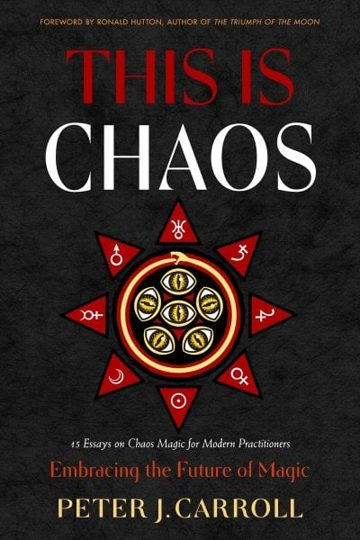</a>

### [This Is Chaos: Embracing the Future of Magic](https://bookshop.org/a/84772/9781578638734){:target="_blank" rel="noopener noreferrer"}
A 2025 essay collection from Weiser, with a foreword by historian Ronald Hutton. The essays cover where chaos magic came from and where current practitioners are taking it.

<a href="https://archive.org/details/dave-evans-the-history-of-british-magic-after-crowley-_-kenneth-grant-amado-crow" target="_blank" rel="noopener noreferrer">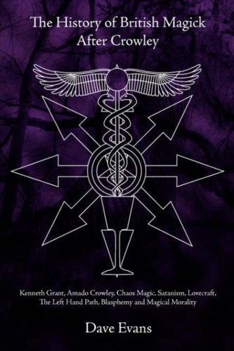</a>

### [The History of British Magic After Crowley by Dave Evans](https://archive.org/details/dave-evans-the-history-of-british-magic-after-crowley-_-kenneth-grant-amado-crow){:target="_blank" rel="noopener noreferrer"}
Evans covers the British occult scene that chaos magic grew out of. He writes as a historian looking in from outside the movement, which gives you context the practical manuals skip.

<a href="https://bookshop.org/a/84772/9781138856110" target="_blank" rel="noopener noreferrer">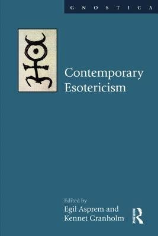</a>

### [Contemporary Esotericism](https://bookshop.org/a/84772/9781138856110){:target="_blank" rel="noopener noreferrer"}
An academic collection on modern esoteric movements. Read the chapters on chaos magic.

### [The Invisibles by Grant Morrison](https://bookshop.org/a/84772/9781799506683){:target="_blank" rel="noopener noreferrer"}
A comic series that Morrison described as "a six-year-long sigil." Read it as a worked example of a hypersigil, which the [glossary](/chaos-magic-terms-explained) explains.

<a href="https://bookshop.org/a/84772/9781578637881" target="_blank" rel="noopener noreferrer">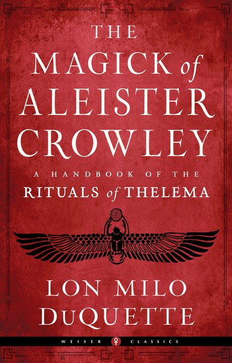</a>

### [The Magick of Aleister Crowley by Lon Milo DuQuette](https://bookshop.org/a/84772/9781578637881){:target="_blank" rel="noopener noreferrer"}
Lon Milo DuQuette walks through the core rituals of Thelema, Crowley's magical and religious system. He explains what each ritual does and how to perform it.

<a href="https://bookshop.org/a/84772/9781578639212" target="_blank" rel="noopener noreferrer">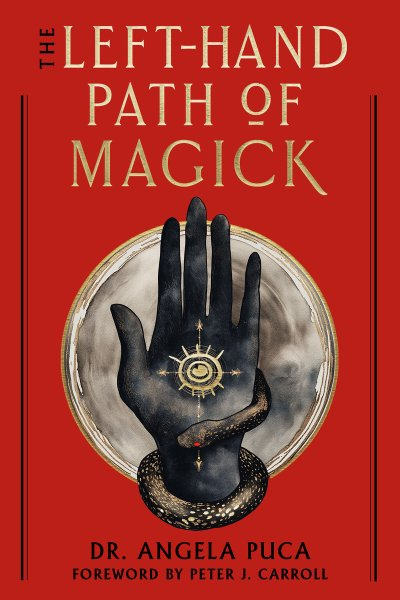</a>

### [The Left-Hand Path of Magick by Dr. Angela Puca](https://bookshop.org/a/84772/9781578639212){:target="_blank" rel="noopener noreferrer"}
Dr. Angela Puca, a scholar of religion, traces the Left-Hand Path from Tantra through Theosophy, Thelema, chaos magick, Satanism and Luciferianism. It's written for general readers and doesn't argue for any one tradition. It comes out December 7, 2026, and is available for pre-order.

## Podcasts

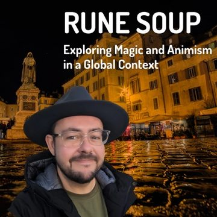

### [Rune Soup](https://runesoup.com/){:target="_blank" rel="noopener noreferrer"}
Gordon White, author of *The Chaos Protocols*, started Rune Soup as a chaos magick blog. The podcast now covers magic, animism and spirit work more broadly, through long interviews with practitioners and scholars.

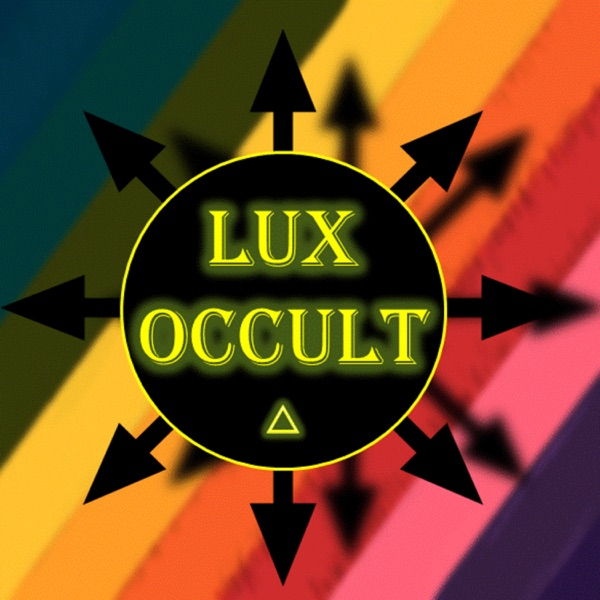

### [Lux Occult](https://creators.spotify.com/pod/profile/luxa-strata/){:target="_blank" rel="noopener noreferrer"}
Luxa Strata interviews magicians, artists and authors about chaos magic, tarot and occult history. There are over 100 episodes.

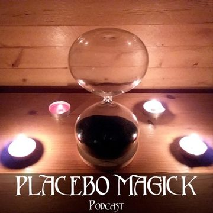

### [Placebo Magick](https://www.farmcodegary.com/){:target="_blank" rel="noopener noreferrer"}
A podcast that examines magick, ritual, tarot all while remaining grounded in a science-based skeptical atheist worldview. The show ended in 2023, but the back catalog is worth listening to.

## Videos

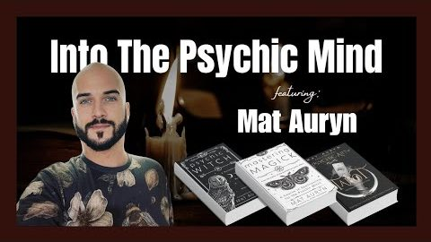

### [Ivy the Occultist](https://www.youtube.com/@IvyTheOccultist){:target="_blank" rel="noopener noreferrer"}
Ivy makes chaos magic and practical occultism accessible without dumbing it down, with clear instructions for techniques like sigil work and servitor creation. Her focus on experimentation and personal results over dogma is perfect for beginners who want to actually do magic rather than endlessly prepare or worry about the "correct" way to practice.

