Most of what we know about Irish paganism comes from three places: medieval manuscripts, archaeology, and the folk customs people kept into the twentieth century. The books and recordings below cover all three, and they're the sources this site's own articles cite.

If you're starting from zero, [the four cycles of Irish mythology](/irish-mythology-four-cycles) and [the Irish pagan holidays](/irish-pagan-holidays) give you the map. For a modern practice built from these sources, start with [Celtic Reconstructionism](/celtic-reconstructionism-introduction-guide). General beginner material lives on the [beginner witchcraft resources](/recommendations/) page.

## Books on Pre-Christian Ireland and the Gods

<a href="https://bookshop.org/a/84772/9780851158563" target="_blank" rel="noopener noreferrer">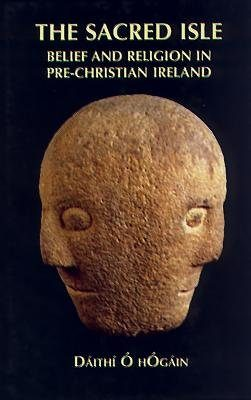</a>

### [The Sacred Isle: Belief and Religion in Pre-Christian Ireland by Dáithí Ó hÓgáin](https://bookshop.org/a/84772/9780851158563){:target="_blank" rel="noopener noreferrer"}
Ó hÓgáin's survey of religion in Ireland before Christianity. The articles on [Lúnasa's origins](/lunasa-pre-christian-origins) lean on it heavily.

<a href="https://bookshop.org/a/84772/9780691183046" target="_blank" rel="noopener noreferrer">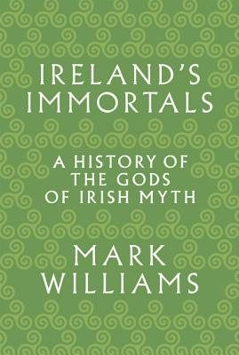</a>

### [Ireland's Immortals: A History of the Gods of Irish Myth by Mark Williams](https://bookshop.org/a/84772/9780691183046){:target="_blank" rel="noopener noreferrer"}
Williams follows the Irish gods from the medieval manuscripts to the modern era, showing how each generation of writers reshaped them. The mythology articles here cite it more than almost any other book.

<a href="https://bookshop.org/a/84772/9780486414416" target="_blank" rel="noopener noreferrer">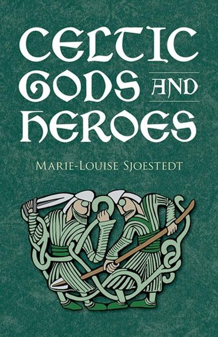</a>

### [Celtic Gods and Heroes by Marie-Louise Sjoestedt](https://bookshop.org/a/84772/9780486414416){:target="_blank" rel="noopener noreferrer"}
A short classic study of the Celtic gods and their roles. The [Cycle of the Kings](/irish-mythology-cycle-of-the-kings) article draws on its chapter on sacral kingship.

<a href="https://bookshop.org/a/84772/9780500051849" target="_blank" rel="noopener noreferrer">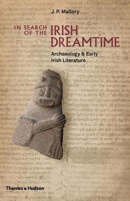</a>

### [In Search of the Irish Dreamtime by J.P. Mallory](https://bookshop.org/a/84772/9780500051849){:target="_blank" rel="noopener noreferrer"}
How much of the Irish myths preserves real Iron Age culture, and how much did medieval scribes build? Mallory's book is a fairly accessible investigation of that question, and his answer is that the stories are a composite of both.

<a href="https://bookshop.org/a/84772/9780500293300" target="_blank" rel="noopener noreferrer">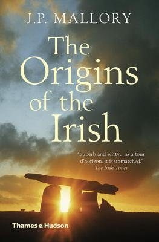</a>

### [The Origins of the Irish by J.P. Mallory](https://bookshop.org/a/84772/9780500293300){:target="_blank" rel="noopener noreferrer"}
Mallory's account of where the Irish came from, using archaeology, language and genetics.

<a href="https://bookshop.org/a/84772/9781578635672" target="_blank" rel="noopener noreferrer">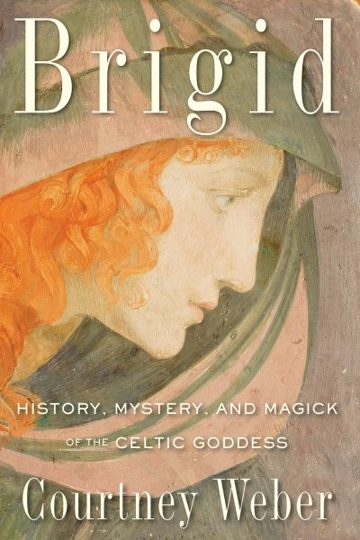</a>

### [Brigid: History, Mystery, and Magick of the Celtic Goddess by Courtney Weber](https://bookshop.org/a/84772/9781578635672){:target="_blank" rel="noopener noreferrer"}
For a longer treatment of the goddess Brigid and Saint Brigid, and how the two fit together, this is the place to start.

## Books on Irish Folk Customs and Folk Magic

<a href="https://bookshop.org/a/84772/9781856350938" target="_blank" rel="noopener noreferrer">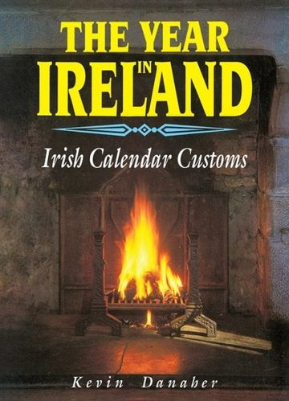</a>

### [The Year in Ireland by Kevin Danaher](https://bookshop.org/a/84772/9781856350938){:target="_blank" rel="noopener noreferrer"}
Danaher's record of the Irish calendar customs, festival by festival. This site's festival articles, from [Samhain divination games](/samhain-divination-games) to Lúnasa, cite it more than any other book.

<a href="https://bookshop.org/a/84772/9781856354424" target="_blank" rel="noopener noreferrer">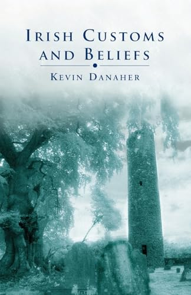</a>

### [Irish Customs and Beliefs by Kevin Danaher](https://bookshop.org/a/84772/9781856354424){:target="_blank" rel="noopener noreferrer"}
Danaher's shorter book on everyday Irish customs and beliefs.

<a href="https://bookshop.org/a/84772/9781786834928" target="_blank" rel="noopener noreferrer">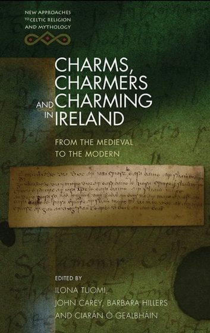</a>

### [Charms, Charmers and Charming in Ireland: From the Medieval to the Modern](https://bookshop.org/a/84772/9781786834928){:target="_blank" rel="noopener noreferrer"}
An academic collection, edited by Ilona Tuomi, John Carey, Barbara Hillers and Ciarán Ó Gealbháin, on Irish verbal charms and the people who used them. The [Irish good luck charms](/irish-good-luck-charms) article starts from it.

<a href="https://archive.org/details/handbookofirishf0000osui" target="_blank" rel="noopener noreferrer">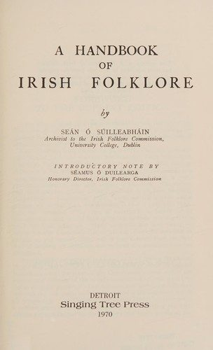</a>

### [A Handbook of Irish Folklore by Seán Ó Súilleabháin](https://archive.org/details/handbookofirishf0000osui){:target="_blank" rel="noopener noreferrer"}
The question guide Ó Súilleabháin wrote in 1942 for the Irish Folklore Commission's collectors. It shows what they asked people about, which tells you what you can expect to find in the archives. Free to borrow on the Internet Archive.

## The Irish Stories in Translation

<a href="https://bookshop.org/a/84772/9780140443974" target="_blank" rel="noopener noreferrer">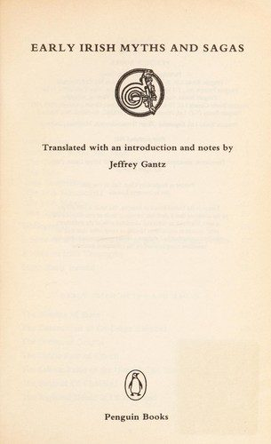</a>

### [Early Irish Myths and Sagas, translated by Jeffrey Gantz](https://bookshop.org/a/84772/9780140443974){:target="_blank" rel="noopener noreferrer"}
A Penguin collection of early Irish tales in English. The mythology cycle articles send you here for several of the major stories, including The Destruction of Da Derga's Hostel.

<a href="https://bookshop.org/a/84772/9780192803733" target="_blank" rel="noopener noreferrer">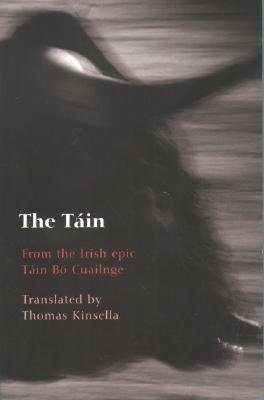</a>

### The Táin, translated by [Thomas Kinsella](https://bookshop.org/a/84772/9780192803733){:target="_blank" rel="noopener noreferrer"} or [Ciaran Carson](https://bookshop.org/a/84772/9780140455304){:target="_blank" rel="noopener noreferrer"}
The two most widely read modern translations of the Táin Bó Cúailnge, the centerpiece of the [Ulster Cycle](/irish-mythology-ulster-cycle). Kinsella's appeared in 1969 and Carson's in 2007.

<a href="https://bookshop.org/a/84772/9780199549856" target="_blank" rel="noopener noreferrer">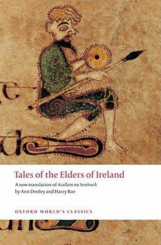</a>

### [Tales of the Elders of Ireland, translated by Ann Dooley and Harry Roe](https://bookshop.org/a/84772/9780199549856){:target="_blank" rel="noopener noreferrer"}
The standard modern English translation of the Acallam na Senórach, where Oisín and Caílte tell Saint Patrick the stories of the [Fianna](/irish-mythology-fenian-cycle).

<a href="https://bookshop.org/a/84772/9780374518943" target="_blank" rel="noopener noreferrer">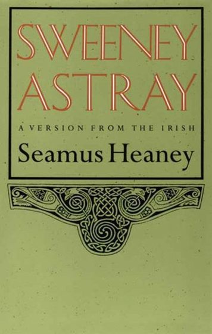</a>

### [Sweeney Astray by Seamus Heaney](https://bookshop.org/a/84772/9780374518943){:target="_blank" rel="noopener noreferrer"}
Heaney's version of Buile Shuibhne, the story of Suibhne, the king driven mad by a saint's curse, from the [Cycle of the Kings](/irish-mythology-cycle-of-the-kings).

<a href="https://archive.org/details/legendaryfiction0000kenn" target="_blank" rel="noopener noreferrer">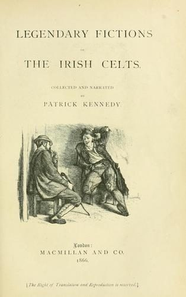</a>

### [Legendary Fictions of the Irish Celts by Patrick Kennedy](https://archive.org/details/legendaryfiction0000kenn){:target="_blank" rel="noopener noreferrer"}
A nineteenth-century collection of Irish folk tales and Fenian ballads. Free to borrow on the Internet Archive.

## Books on Ogham

<a href="https://bookshop.org/a/84772/9781905713028" target="_blank" rel="noopener noreferrer">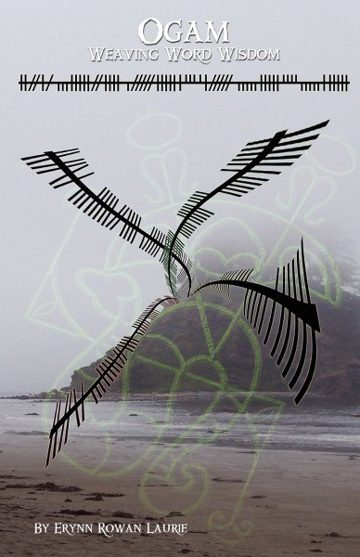</a>

### [Ogam: Weaving Word Wisdom by Erynn Rowan Laurie](https://bookshop.org/a/84772/9781905713028){:target="_blank" rel="noopener noreferrer"}
Laurie works with ogham as a tool for divination and poetry, grounded in the early Irish sources. Start with the [introduction to ogham](/ogham-an-introduction) and [ogham divination](/how-to-read-ogham-divination) guides here.

<a href="https://www.goodreads.com/book/show/6898902-ogham" target="_blank" rel="noopener noreferrer">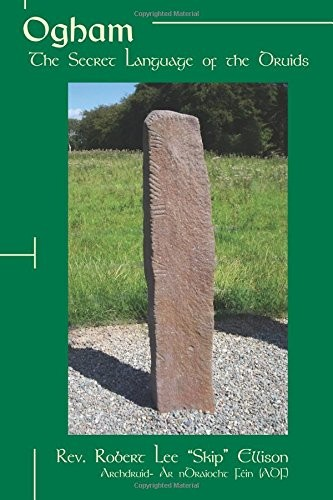</a>

### [Ogham: The Secret Language of the Druids by Robert Lee Ellison](https://www.goodreads.com/book/show/6898902-ogham){:target="_blank" rel="noopener noreferrer"}
Skip Ellison, Archdruid Emeritus of Ár nDraíocht Féin (ADF), bases his guide on the *Auraicept na nÉces*, the medieval Irish scholars' primer on ogham. He goes through each letter, its tree and its associations. It's a good complement to Laurie's book: Ellison gives you a solid reference for the letters, and Laurie shows you how to work with them.

## Books on Modern Practice

<a href="https://bookshop.org/a/84772/9781536558241" target="_blank" rel="noopener noreferrer">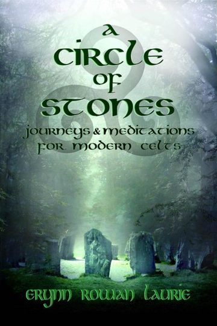</a>

### [A Circle of Stones: Journeys and Meditations for Modern Celts by Erynn Rowan Laurie](https://bookshop.org/a/84772/9781536558241){:target="_blank" rel="noopener noreferrer"}
Laurie is one of Celtic Reconstructionism's founding voices. Her book of meditations draws on the land, sea and sky cosmology explained in [what CR believes](/celtic-reconstructionism-theology-cosmology).

<a href="https://bookshop.org/a/84772/9781785351457" target="_blank" rel="noopener noreferrer">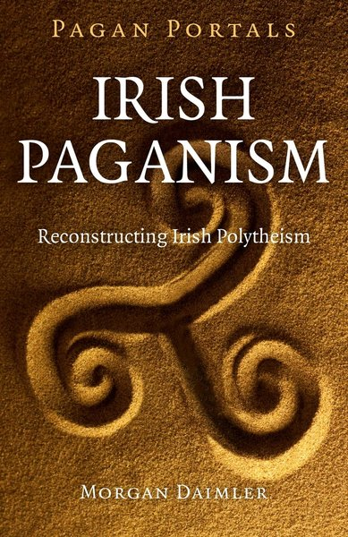</a>

### [Pagan Portals: Irish Paganism by Morgan Daimler](https://bookshop.org/a/84772/9781785351457){:target="_blank" rel="noopener noreferrer"}
Morgan Daimler writes as a practitioner instead of an academic, and their scholarship holds up. This short introduction covers Irish cosmology, the gods and spirits, ritual structure, daily practice and the holidays, for anyone taking a reconstructionist approach. The [Celtic Reconstructionism guide](/celtic-reconstructionism-introduction-guide) here is a good companion to it.

## Podcasts

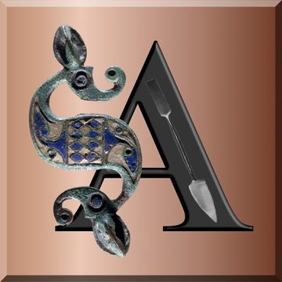

### [Story Archaeology](https://storyarchaeology.com/){:target="_blank" rel="noopener noreferrer"}
Chris Thompson and Isolde Carmody combine storytelling with close reading of the early Irish texts, with Isolde working from the original language. Their Circling the Táin series reads the Táin and its prelude tales episode by episode, and the [Ulster Cycle](/irish-mythology-ulster-cycle) article links it throughout. The pre-2021 episodes are archived, and Chris still publishes new ones.

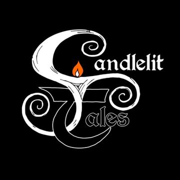

### [Candlelit Tales](https://candlelittales.ie/){:target="_blank" rel="noopener noreferrer"}
Storytellers Aron and Sorcha Hegarty retell Irish myths to live audiences in Dublin, set to original music. The mythology articles here link their episodes next to the translations.

## Videos

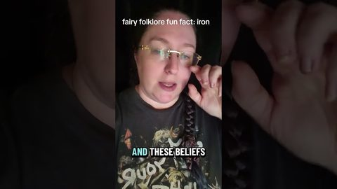

### [Morgan Daimler](https://www.youtube.com/@MorganDaimlerfairies){:target="_blank" rel="noopener noreferrer"}
Daimler brings scholarly rigor to Irish paganism and fairy folklore, always distinguishing between authentic historical practices and modern inventions with sources to back up every claim. If you're interested in Celtic traditions, Morgan's work teaches you to tell the difference between what people actually practiced and what recent authors made up. It also offers practical guidance on working with the Good Neighbors safely.

## Free Online Resources

### [Dúchas](https://www.duchas.ie/en){:target="_blank" rel="noopener noreferrer"}
The digitized Schools' Collection: folklore written down by Irish schoolchildren from their families and neighbors between 1937 and 1939. Articles like [the evil eye in Irish folklore](/the-evil-eye-in-irish-folklore) are built from these records.

### [CELT: Corpus of Electronic Texts](https://celt.ucc.ie/){:target="_blank" rel="noopener noreferrer"}
University College Cork's library of early Irish texts, many with English translations. It holds the academic standard translation of the Táin, Cecile O'Rahilly's Recension 1.

### [Mary Jones's Celtic Literature Collective](https://www.maryjones.us/ctexts/index_irish.html){:target="_blank" rel="noopener noreferrer"}
A large free collection of Irish texts in translation, organized by story.

### [The CR FAQ](https://www.paganachd.com/faq/index.html){:target="_blank" rel="noopener noreferrer"}
The foundational text of Celtic Reconstructionism, written collectively by Kathryn Price NicDhàna, Erynn Rowan Laurie, C. Lee Vermeers and Kym Lambert ní Dhoireann. The full text is free.
