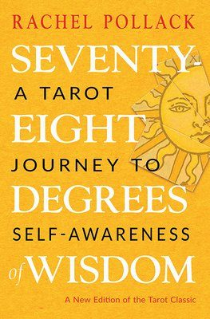
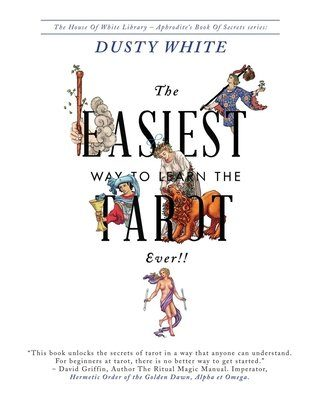
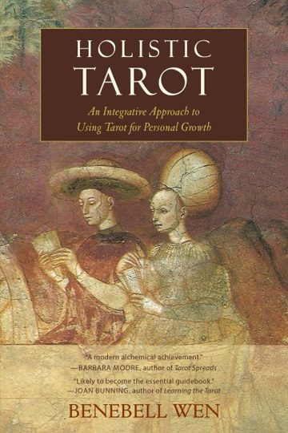
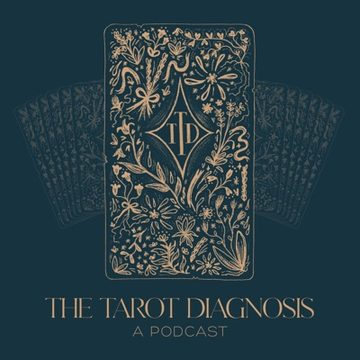

The little booklet that comes with most decks gives a few words per card. That's enough to get you started and not much more. A good tarot book shows you where the imagery comes from and how the cards read together in a spread.

I don't recommend much study or theory when you're starting out. Start by doing readings for yourself and for other people, and pull one card each day. The meanings stick faster when you use them. After that, study whatever parts of tarot you feel drawn to (more on that below).

[How to read tarot for beginners](/9-tarot-tips-for-beginners) covers your first readings, and [reading patterns in tarot spreads](/tarot-cards-symbolism-imagery-and-interpretation) picks up where single-card meanings stop. For general starting points beyond tarot, see [beginner witchcraft resources](/recommendations/).

## Tarot Books for Beginners

### [78 Degrees of Wisdom by Rachel Pollack](https://bookshop.org/a/84772/9781578636655){:target="_blank" rel="noopener noreferrer"}
This one is a classic, but for good reason! Pollack goes more in-depth than almost any other book I've found on the imagery in and history of the Rider-Smith deck.

### [The Easiest Way to Learn the Tarot—EVER!! by Dusty White](https://www.amazon.com/Easiest-Way-Learn-Tarot-EVER-Aphrodites-ebook/dp/B07FNZ8HV2/){:target="_blank" rel="noopener noreferrer"}
This book teaches tarot by having you do it. Dusty White, a professional reader and teacher, built it as a workbook of exercises and games, so you're reading the cards from the first chapter and learning the meanings by using them.

## Books for Going Deeper

Once you've been reading for a while, you'll find parts of tarot you want to know more about, like the history of the cards or how spreads are built. Follow that interest.

### [Holistic Tarot by Benebell Wen](https://bookshop.org/a/84772/9781583948354){:target="_blank" rel="noopener noreferrer"}
An 896-page reference that covers tarot history, card meanings and spreads, with an analytical, psychology-minded approach.

## A Deck to Learn With

The [Rider-Waite-Smith deck](https://bookshop.org/a/84772/9780913866139){:target="_blank" rel="noopener noreferrer"} is the beginner standard, and most tarot books, including 78 Degrees of Wisdom, are written around its imagery. If you want to start before buying a deck, there's a [printable version of the deck](https://ko-fi.com/s/5f1138f832?utm_source=website){:target="_blank" rel="noopener noreferrer"} for $1.99.

## Podcasts

### [The Tarot Diagnosis](https://www.thetarotdiagnosis.com/){:target="_blank" rel="noopener noreferrer"}
A podcast hosted by two therapists who love tarot that highlights the intersection of psychology, mental health, and tarot.

## Free Tarot Resources

### [Learning the Tarot by Joan Bunning](https://www.learntarot.com/){:target="_blank" rel="noopener noreferrer"}
A free, self-paced online course in 19 lessons, online since 1995. Bunning later turned it into a book, but the full course is still free on her site.

### [Free Beginner Tarot Spreads](/free-tarot-spreads/beginner/)
The beginner spreads on this site, each with position-by-position instructions.
